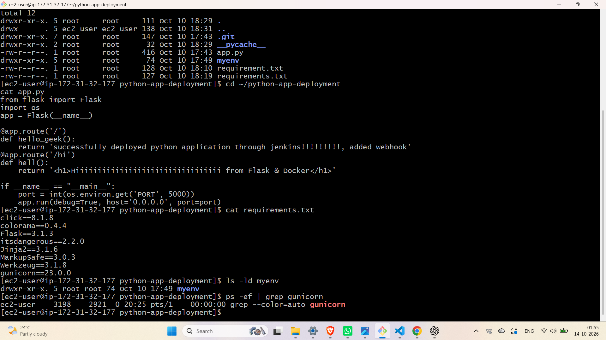
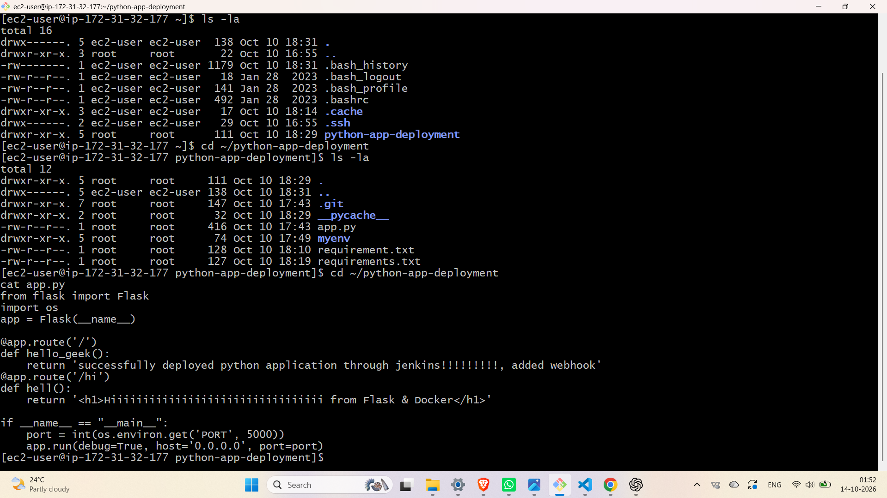
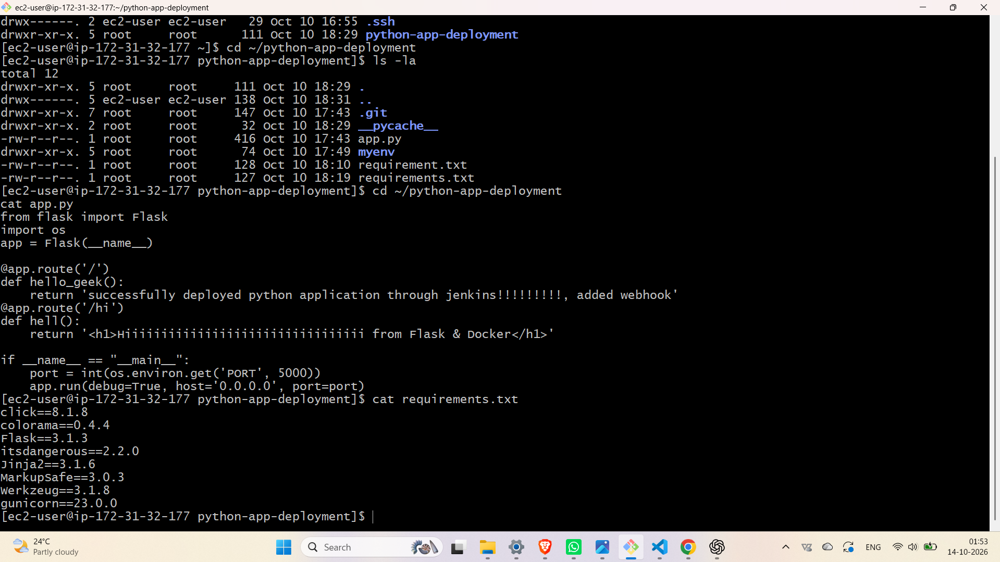
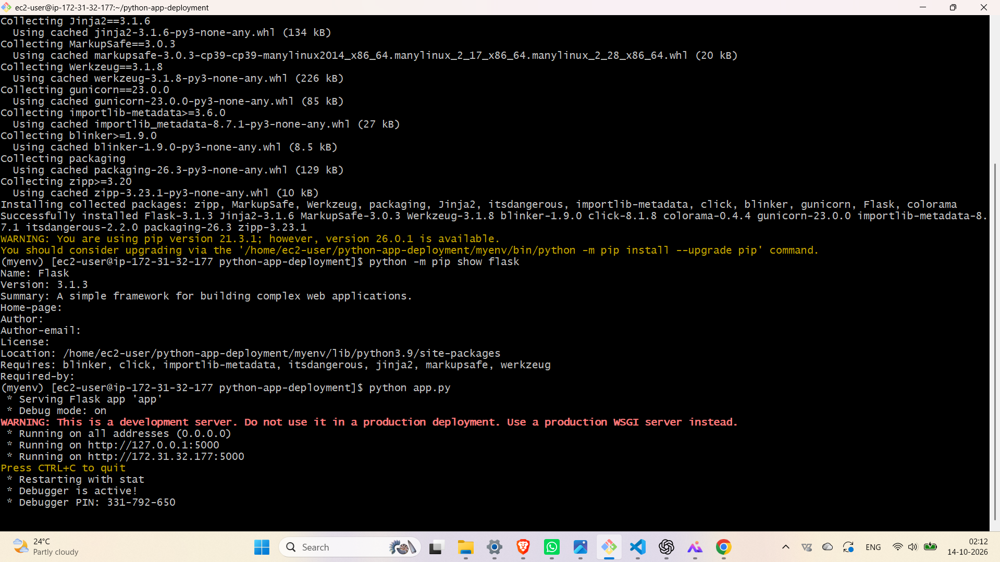
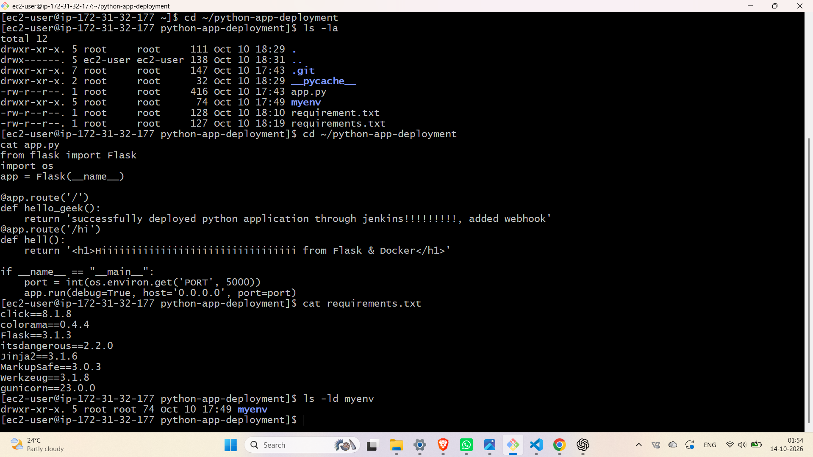
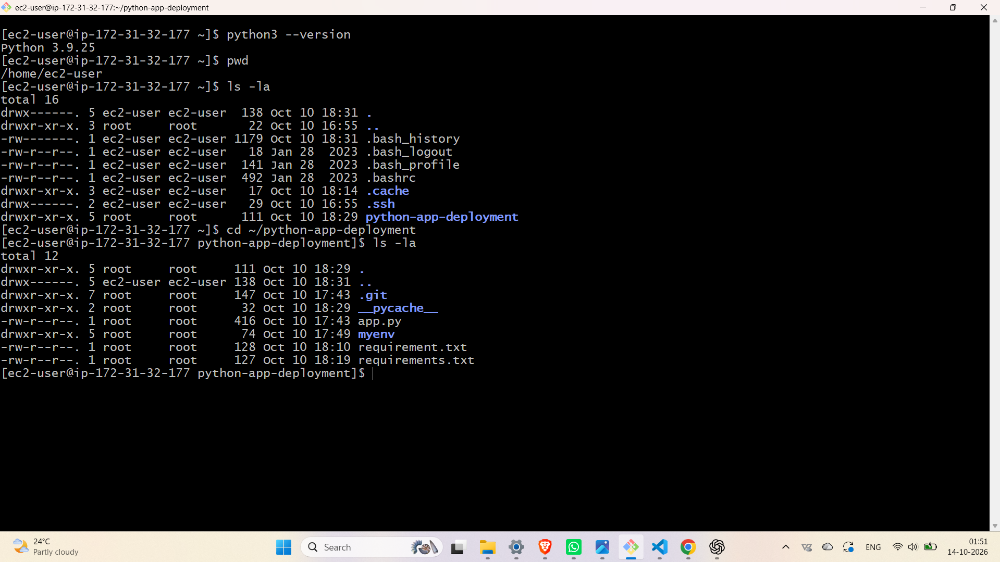
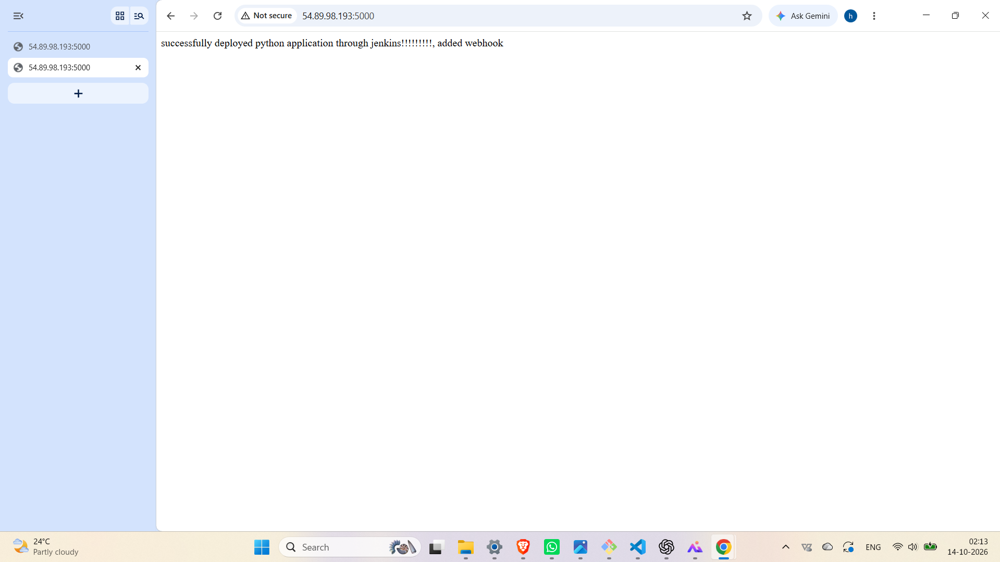

# 🚀 Python Flask Application Deployment on AWS EC2

## 📌 Project Overview
This project demonstrates deploying a Python Flask web application on an AWS EC2 instance using Amazon Linux.

The goal is to learn cloud deployment, Linux server management, and Python application configuration.

## 🎯 Project Objectives
- Deploy a Python Flask application on AWS EC2.
- Understand Linux commands and server configuration.
- Install Python dependencies.
- Configure Security Group rules.
- Access the application using a public IP address.

## 🛠️ Technologies Used
- AWS EC2
- Amazon Linux
- Python 3
- Flask
- pip
- Linux
- Git and GitHub

## 📂 Project Structure
```text
python-app-deployment/
├── app.py
├── requirements.txt
└── README.md
```

## 💻 Deployment Steps

### 1. Update the Server
```bash
sudo yum update -y
```

### 2. Install Required Packages
```bash
sudo yum install python3 python3-pip git -y
```

### 3. Check Versions
```bash
python3 --version
git --version
```

### 4. Create a Virtual Environment
```bash
python3 -m venv myenv
source myenv/bin/activate
```

### 5. Install Dependencies
```bash
pip install -r requirements.txt
```

### 6. Run the Application
```bash
python app.py
```

## 🔐 Security Group
- SSH: Port 22
- Flask Application: Port 5000

Restrict SSH access to your own IP address whenever possible.

## 🌐 Access the Application
```text
http://<EC2-PUBLIC-IP>:5000
```

Replace the placeholder with your EC2 public IP address.

## 📸 Project Screenshots
Screenshots demonstrate EC2 configuration, Security Group settings, project structure, dependency installation, and successful application deployment.

## 🧠 Key Learnings
- AWS EC2 configuration
- Linux commands
- Python virtual environments
- Flask application deployment
- Network configuration
- Troubleshooting deployment issues

## 🚀 Future Improvements
- Configure Nginx and Gunicorn.
- Add a custom domain and HTTPS.
- Implement CI/CD using GitHub Actions.

## 👨‍💻 Author
**Harshvardhan Kalugade**

Aspiring Cloud Engineer | AWS | Linux | Python

## 📸 Project Deployment Screenshots

This section demonstrates the step-by-step deployment of a Python Flask application on AWS EC2.

### 1. EC2 Instance
Started and checked the EC2 instance in the AWS Management Console.


### 2. EC2 Security Group
Checked the Security Group configuration and inbound ports required for application access.


### 3. Project Folder
Viewed the project folder on the EC2 instance.


### 4. Python Version and Project Directory
Verified the installed Python version and navigated to the project directory.



### 5. Python App Code and Project Structure
Reviewed the Python application code and project structure.


### 6. Python Application Code and Dependencies
Checked the `app.py` file and the required application dependencies.


### 7. Python Dependencies Installation
Installed Flask and the other required Python packages.


### 8. Python Application Configuration and Process Check
Checked the application configuration and process status during deployment.


### 9. Python App Deployment Process
Reviewed the project files and terminal commands used during deployment.



### 10. Python App Successfully Deployed
Final screenshot showing the deployed Python application in the browser.

